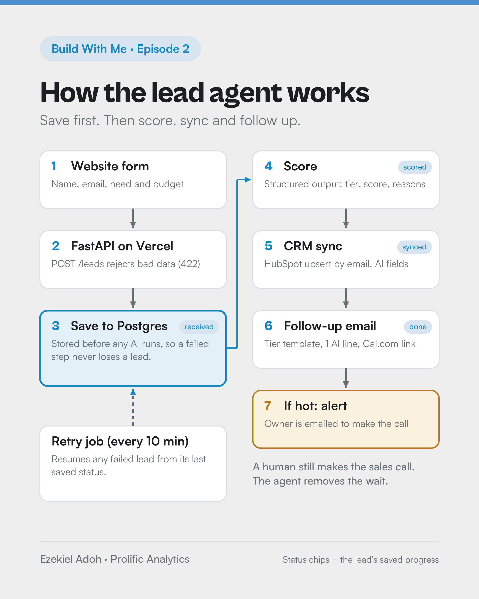
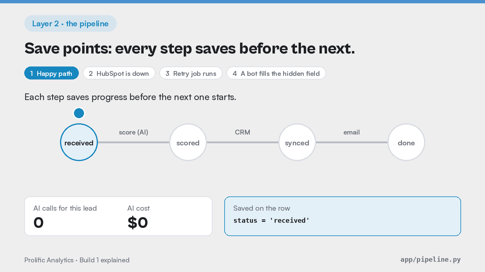

# AI Lead Qualification Agent

A website form that replies in seconds. Every inbound lead is saved first, scored by an LLM, synced to HubSpot and sent a personal follow-up with a prefilled booking link. You get an alert for the hot ones, and failed steps retry on their own, so no lead is lost.

Build 1 of the **Build With Me** series by [Ezekiel Adoh, Prolific Analytics](https://www.prolificanalytics.io). It is a sanitized copy of the code running in production. The real-run numbers below are from test leads, not client results.



## Results

**Live end to end** (Oct 21, 2026, 7 test leads through the production deploy, from `/metrics`)

| Metric | Result |
|---|---|
| Median time to first reply | **6.8 s** |
| Leads lost | **0** |
| Spam replies sent / duplicate emails | **0 / 0** |
| LLM cost per lead | **$0.000245** (about 2.5 cents per 100 leads) |
| Slowest reply | 82 min: the go-live lead that waited for bug fixes, then was delivered by the retry job |

**Scoring accuracy** (30 held-out leads the prompt never saw, labeled by hand first)

| Prompt | Accuracy | Hot-lead recall | Hot leads buried as cold/spam |
|---|---|---|---|
| `score_lead_v2.md` (default) | 98.9% (3 runs) | 100% | 0 |

The full eval history, including the misses, is in [docs/METRICS.md](docs/METRICS.md).

## How it works

```
form ──► POST /leads ──► save (received) ──► score (scored) ──► HubSpot (synced) ──► email (done)
                              ▲                                                    └─► alert you if hot
                              └──────────── /cron/retry every 10 min resumes from the last saved status
```

1. **Validate, then save, then think.** Bad input gets a 422 and never touches the database. Good input is written before any AI runs. [Layer 1, explained](docs/explained/01-form-to-saved-lead.md)
2. **Resumable steps.** Each step saves its status, so a retry picks up where the lead stopped and never pays to rescore. [Layer 2, explained](docs/explained/02-the-pipeline.md)
3. **Structured output.** The model must return tier, score and reasons in a fixed schema. Guardrails clamp each score into its tier's band and strip links from the AI-written line.
4. **Human-written emails plus one AI sentence.** The model personalizes one line, and you write the rest. No promises you didn't make.
5. **Safe by default.** `SEND_EMAILS=false` is a dry run. With it on, the app refuses to send while any setting is still a placeholder (`/health` reports `config_ok`).



## Stack

| Layer | Tool | Why |
|---|---|---|
| API | FastAPI on Vercel | Small Python API that deploys from GitHub |
| Database | Postgres (Neon), SQLite locally | Every lead is saved before processing |
| Scoring | OpenAI, small model with structured outputs | Fixed fields, about $0.0002 per lead |
| CRM | HubSpot (free) | Upsert by email, so no duplicate contacts |
| Email | Resend | Idempotency keys, so a retry never double-sends |
| Booking | Calendly or Cal.com | Link prefilled with `?name=&email=` |
| Retries | GitHub Actions, every 10 min | Free. Best-effort timing, so see the note below |

## Run it locally (about 10 minutes)

```bash
python3.12 -m venv .venv && source .venv/bin/activate
pip install -r requirements.txt
cp .env.example .env          # add your keys; SEND_EMAILS=false keeps it a dry run
pytest -q                     # 15 tests, no keys needed
uvicorn app.main:app --reload
open http://localhost:8000    # the lead form
```

Useful scripts:

```bash
python -m scripts.smoke_score                     # score 3 sample leads with your OpenAI key
python -m scripts.create_hubspot_properties       # one-time: add the AI fields to HubSpot
python -m scripts.run_evals --split dev           # measure agreement with your labels
TEST_EMAIL=you@yourdomain.com python -m scripts.send_test_lead http://localhost:8000 hot
```

## Deploy

1. **Database.** Create a Postgres database (the Neon free tier works) in the same region as your Vercel functions. Copy the pooled connection string.
2. **Vercel.** Import this repo, then add the variables from `.env.example` under Settings → Environment Variables (Production). Use `DATABASE_URL` from step 1 and a long random `CRON_SECRET`.
3. **Email domain.** Add your domain in Resend. If your DNS is on Cloudflare, set the Resend records to DNS only. Wait for Verified, then set `SEND_EMAILS=true`.
4. **Redeploy** after any variable change, and confirm a new deployment appears. Settings are read at build time.
5. **Retries.** In GitHub, add the repo secrets `APP_URL` (your Vercel URL) and `CRON_SECRET`. The workflow in `.github/workflows/retry.yml` calls `/cron/retry` every 10 minutes.
6. **Run the [go-live checklist](docs/GO-LIVE-CHECKLIST.md)** before the first real lead.

**Retry note:** GitHub runs scheduled workflows on a best-effort basis. In testing, 2 runs happened in 7.5 hours. For client work, point a dedicated scheduler (QStash, cron-job.org or Vercel Cron) at `/cron/retry`.

## What broke

All tests passed before go-live, and the real world still found 4 bugs: a DNS setting, a typo in code that only runs in production, a placeholder API key, and a placeholder booking link, followed by a redeploy that never ran. Each one is in [docs/BREAKLOG.md](docs/BREAKLOG.md), with how it was noticed and fixed. The placeholder check and the go-live checklist exist because of them.

## Layout

```
app/main.py          API: /leads, /cron/retry, /metrics, /health
app/config.py        settings plus the placeholder check
app/pipeline.py      resumable steps: score → CRM → email
app/scoring.py       LLM call plus guardrails
app/prompts/         scoring rubrics (v2 is the default)
app/crm.py           HubSpot upsert by email
app/emailer.py       templates, booking link, Resend sender
app/db.py            lead log with dedupe (SQLite locally, Postgres in prod)
evals/               60 labeled synthetic leads and past eval runs
docs/                decisions, break log, metrics, labeling guide, go-live checklist
public/index.html    the lead form
```

## Notes

- All names and emails in `evals/` and `tests/` are made up and use the reserved `.example` domain.
- Keep `.env` out of git (it is in `.gitignore`), and keep secrets out of screenshots.
- The scoring rubric is tuned for small and mid-size service businesses (dental, med spa and similar). Edit `app/prompts/score_lead_v2.md`, label 20+ of your own leads, and rerun the evals before trusting it with your pipeline.

MIT License. If this saves you a lead, I'd like to hear about it: [prolificanalytics.io](https://www.prolificanalytics.io).
